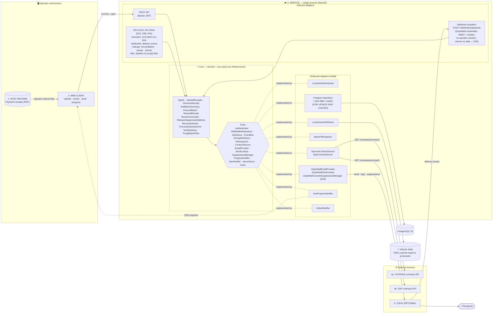
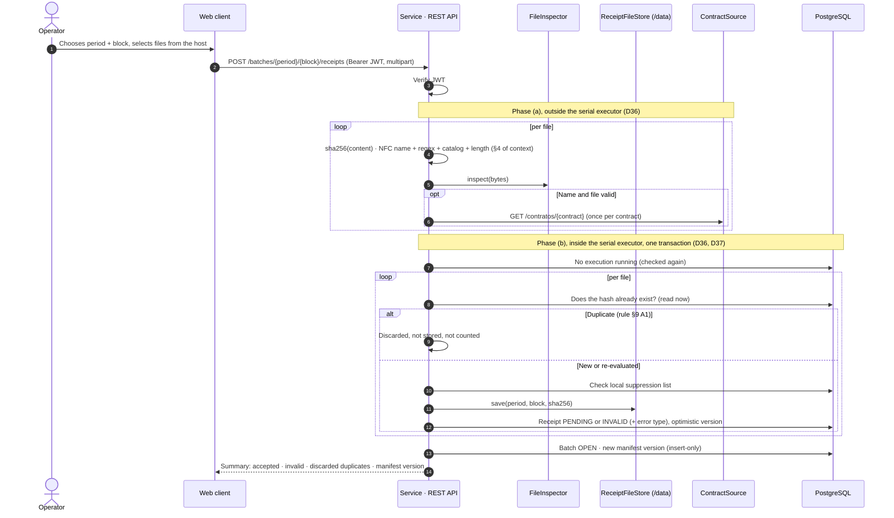
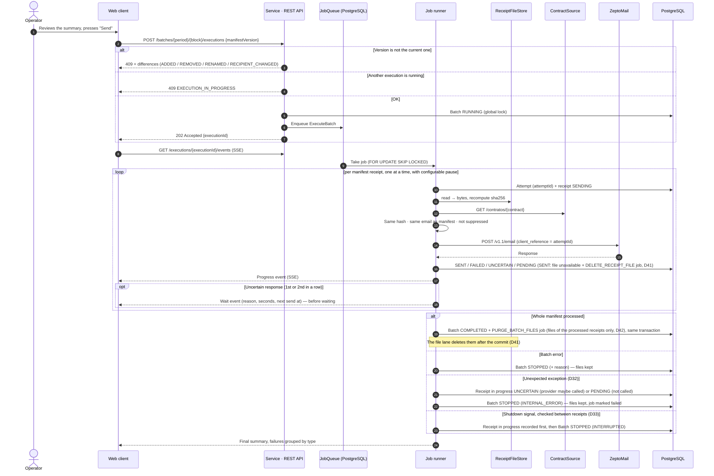
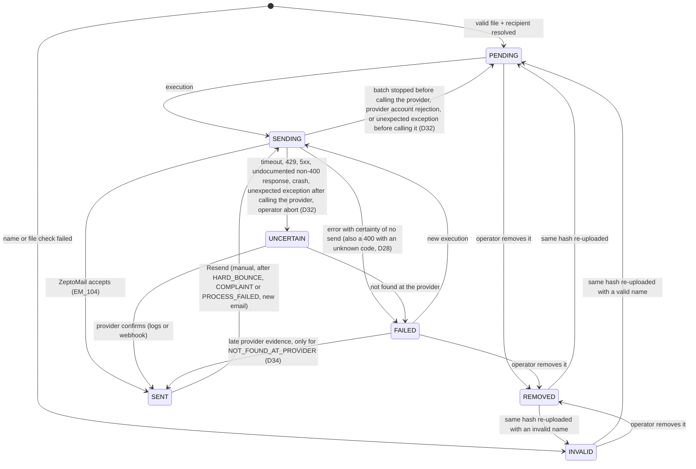
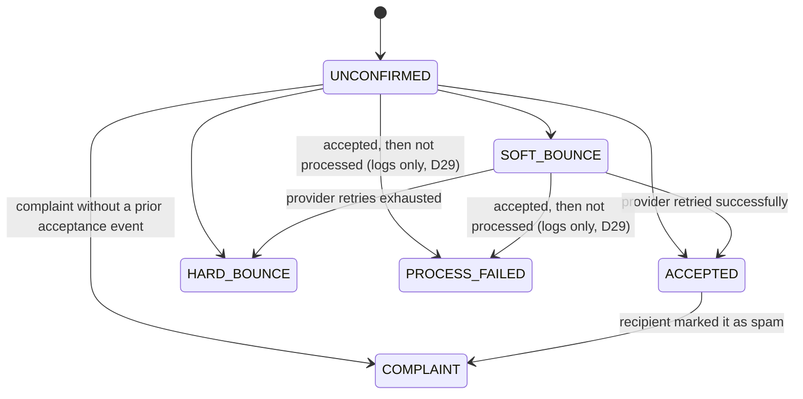

# Bulk Mailer — Arquitectura (versión 2, aprobada el 2026-10-31)

Arquitectura acordada (hexagonal, monolito modular, una instancia) con las decisiones de `decisiones.md` aplicadas.
Identificadores en inglés. Los datos de negocio que ve el usuario final (nombres de archivo, `CNCPT`/`CNTRT`,
claves del catálogo de conceptos, asunto y cuerpo del correo) siguen en español.

## 1. Componentes

## 2. Puertos y adaptadores

| Port | Responsibility | Initial adapter | Future adapter |
|---|---|---|---|
| `Authenticator` | Sign in, issue and verify JWT (access 15 min, refresh 8 h), one role `operator` | `LocalJwtAuthenticator` (Argon2, accounts provisioned in DB) | AD / Entra ID |
| `BulkMailerRepository` | Receipts, attempts, manifests, batches, events, suppressions, alerts, audit. Receipts and batches carry a row version: a save based on a stale version fails (`ConcurrentModificationError`); manifests are insert-only (`DuplicateManifestVersionError`) (D37) | PostgreSQL 18 | — |
| `JobQueue` | Batch execution, reconciliation, delivery-event processing; recovery after crash; `hasPending` so periodic work is not queued twice (D38). A job can also be queued inside a repository transaction (`tx.jobs`, same table): it exists if and only if the transaction commits (D40) | Jobs table in PostgreSQL | Kafka / RabbitMQ |
| `EventBus` | Domain and progress events, at least once. An event that fails 10 deliveries is dead: it leaves the pending window, raises `OUTBOX_EVENT_DEAD` and can be retried by the operator (D39) | Outbox in PostgreSQL | Kafka |
| `ReceiptFileStore` | Save, read and purge PDFs by `(period, block, sha256)` | `LocalVolumeFileStore` (`/data`) | S3 / Azure Blob |
| `FileInspector` | Verdict on the file (see §2.1) | `BasicPdfInspector` | `QpdfClamAvInspector` |
| `ContractSource` | `get(contract)` → recipient | `TayronaContractSource` (blocks 1–4, 6) · `SapContractSource` (block 5) · `FakeContractSource` (non-prod) | — |
| `EmailProvider` | Send a message and classify the response | `ZeptoMailEmailProvider` | Another provider |
| `SendLookup` | Look up a send by `client_reference` | `ZeptoMailSendLookup` (logs API, OAuth) | — |
| `SuppressionManager` | Remove an address from the provider suppression list | `ZeptoMailConsoleSuppressionManager`: no API is documented, the operator removes it in the console and confirms it (D19) | `ZeptoMailSuppressionManager` (API), if Zoho confirms one |
| `ProgressNotifier` | Real-time progress | `SseProgressNotifier` | WebSocket |
| `AlertNotifier` | Deliver persisted typed alerts. The operator lists them newest first, filters them (`pending`, type, subject) and acknowledges them (D46) | `UiAlertNotifier` | Email / Teams / Slack |
| `SecretStore` | Credentials | Environment secrets manager | — |
| `Clock` | Current time, `America/Bogota` period, waits, reconciliation schedule | `SystemClock` | — |

Inbound adapters: REST API (JWT on every query and command), webhook reception (ZeptoMail's HMAC + custom header; no operator session and no data returned, D20), job runner with four lanes (D21, D38, D41): execution (one batch at a time), webhooks (never behind a lookup), lookups in the provider logs (reconciliation, sweep, per-minute check, at most `DELIVERY_CHECK_BATCH_SIZE` sends per check) and files (deletion of receipt files that are no longer needed, and the periodic orphan sweep). Every receipt change of every lane goes through the same serial executor.

### 2.1 `BasicPdfInspector` (verificación sencilla)

| # | Check | Rejection |
|---|---|---|
| 1 | Size ≤ 15 MB, checked before reading | `ATTACHMENT_TOO_LARGE` |
| 2 | `%PDF-1.x` / `%PDF-2.0` at byte 0 and `%%EOF` as last non-empty element | `NOT_A_PDF` |
| 3 | No `/Encrypt` entry | `PDF_ENCRYPTED` |
| 4 | Plain-text search of `/JavaScript`, `/JS`, `/OpenAction`, `/AA`, `/Launch`, `/EmbeddedFile`, `/RichMedia`, `/XFA`, `/SubmitForm` | `PDF_ACTIVE_CONTENT` |
| 5 | Number of `%%EOF` markers ≤ threshold + 1 (incremental revisions, default 0) | `PDF_INCREMENTAL_UPDATE` |

Known limitation: it does not see names that are obfuscated or hidden inside compressed streams, does not detect malformed files
built to exploit parsers, and runs no antivirus. That is what `QpdfClamAvInspector` covers when the service grows.

## 3. Secuencia — Carga

Every command follows the same two phases (D36): what calls an external service (contract sources, the inspector, the provider) runs outside the serial executor; inside it, one short transaction reads again the state the decision depends on, decides and writes. Refresh recipients, conflict resolution and resend work the same way; resend and the execution have three sections (record the attempt · call the provider outside · record the outcome).

## 4. Secuencia — Envío

- **Operator abort (D32):** `POST /executions/{executionId}/abort` `{ note, force? }` does for one execution what the recovery at startup does: its `SENDING` receipts become `UNCERTAIN` and it stops as `INTERRUPTED`. Refused (`409 EXECUTION_STILL_ACTIVE`) while the last progress event is younger than `EXECUTION_ABORT_AFTER_MINUTES` (a growing wait counts until its next send), unless forced. A run that was still alive notices it at its next write and takes no other receipt.
- **Shutdown (D33):** the job lanes stop before the HTTP server and the database close; each waits for its job in progress at most `SHUTDOWN_TIMEOUT_SECONDS`. Past that, the recovery at the next start covers what was left `SENDING`.

## 5. Estados del soporte (envío)

- `SENT` and `UNCERTAIN` never go to `REMOVED`.
- `FAILED → SENT` exists only for late evidence (webhook or logs) of the latest attempt of a receipt failed as `NOT_FOUND_AT_PROVIDER`; it raises `LATE_SEND_EVIDENCE` (D34). Any other `FAILED` is a certainty of no send and does not change.
- A failed resend ends in `FAILED` and enters the next normal manifest (D7c).

## 6. Estado de entrega (solo `SENT`)

The delivery state only advances. `ACCEPTED` = the recipient's server accepted it; not a guarantee of reaching the inbox.

## 7. Estado del lote

```mermaid
stateDiagram-v2
    [*] --> OPEN: first upload
    OPEN --> OPEN: upload / remove (new manifest version)
    OPEN --> RUNNING: send (current version)
    RUNNING --> COMPLETED: whole manifest processed → files of processed receipts purged (D42)
    STOPPED --> COMPLETED: settlement only: nothing ready, nothing SENDING or UNCERTAIN (D41)
    RUNNING --> STOPPED: batch error, unexpected exception (INTERNAL_ERROR), shutdown or operator abort (INTERRUPTED); files kept
    STOPPED --> RUNNING: send (current version)
    STOPPED --> OPEN: upload / remove
    COMPLETED --> OPEN: upload / remove
```

Only one execution at a time in the whole system. While it runs, upload, remove, send and resend are disabled.

`STOPPED → COMPLETED` exists only for settlement (D41): when whatever resolves a receipt of a stopped batch (a webhook, the logs, the operator) leaves it with nothing ready to send and nothing `SENDING` or `UNCERTAIN`, the batch completes (`BATCH_COMPLETED` event) and its processed files are purged. An `OPEN` batch is never closed automatically.

## 8. Catálogo de errores (inglés)

| Context (ES) | English | Kind |
|---|---|---|
| `NOMBRE_INVALIDO` | `INVALID_NAME` | File |
| `CONCEPTO_NO_CATALOGADO` | `UNKNOWN_CONCEPT` | File |
| `NOMBRE_DEMASIADO_LARGO` | `NAME_TOO_LONG` | File |
| `ADJUNTO_DEMASIADO_GRANDE` | `ATTACHMENT_TOO_LARGE` | File |
| — (D31) | `DUPLICATE_CONFLICT` | Same content under different names; blocked until the operator chooses |
| `ARCHIVO_NO_ES_PDF` | `NOT_A_PDF` | File |
| `PDF_CIFRADO` | `PDF_ENCRYPTED` | File |
| `PDF_CONTENIDO_ACTIVO` | `PDF_ACTIVE_CONTENT` | File |
| `PDF_MODIFICADO` | `PDF_INCREMENTAL_UPDATE` | File |
| `ARCHIVO_MALICIOSO` | `MALICIOUS_FILE` (only with the future inspector) | File |
| `DUPLICADO` | `DUPLICATE` (reported in the upload summary; not stored) | Upload |
| `ARCHIVO_NO_ACCESIBLE` | — (no shared drive) | — |
| — | `FILE_NOT_AVAILABLE` (file purged; re-upload needed) | Send |
| `CONTRATO_NO_EXISTE` | `CONTRACT_NOT_FOUND` | Recipient |
| `CONTRATO_INACTIVO` | `CONTRACT_INACTIVE` | Recipient |
| `CONTRATO_SIN_CORREO` | `CONTRACT_WITHOUT_EMAIL` | Recipient |
| `CORREO_SUPRIMIDO` | `EMAIL_SUPPRESSED` | Recipient |
| `FUENTE_NO_DISPONIBLE` | `SOURCE_UNAVAILABLE` ("could not query the source"; receipt `FAILED`, D7a) | Recipient / batch |
| `DESTINATARIO_CAMBIO` | `RECIPIENT_CHANGED` | Send |
| `ARCHIVO_MODIFICADO` | `FILE_MODIFIED` | Send |
| `PROVEEDOR_RECHAZO` | `PROVIDER_REJECTED` | Send |
| `PROVEEDOR_NO_DISPONIBLE` | `PROVIDER_UNAVAILABLE` | Send / batch |
| `NO_CONSTA_EN_PROVEEDOR` | `NOT_FOUND_AT_PROVIDER` | Send |
| `ERROR_INTERNO` | `INTERNAL_ERROR` | Send / batch |
| `PROVEEDOR_CUENTA` | `PROVIDER_ACCOUNT` | Batch |
| `AGENTE_NO_DISPONIBLE` | — (no agent) | — |
| `INTERRUMPIDO` | `INTERRUPTED` | Batch |
| `AUDITORIA_INMUTABLE` | `AUDIT_IMMUTABLE` | Audit |
| `WEBHOOKS_NO_RECIBIDOS` | `WEBHOOKS_NOT_RECEIVED` | Alert |
| — (D34) | `LATE_SEND_EVIDENCE` (a send failed as not found did go out; now SENT) | Alert |
| — (D34) | `DUPLICATE_SEND_DETECTED` (an older send believed not sent went out, and a later one too) | Alert |
| — (D39) | `OUTBOX_EVENT_DEAD` (a domain event could not be delivered after 10 attempts) | Alert |
| — (D41) | `FILE_PURGE_FAILED` (receipt files no receipt needs could not be deleted) | Alert |
| — (D43) | `UNCERTAIN_UNRESOLVED` (an uncertain send still unresolved after its last scheduled lookup) | Alert |
| — (D45) | `WEBHOOK_UNPARSED` (an authenticated webhook with no event of ours could be read) | Alert |
| `AGREGADO` / `EXCLUIDO` | `ADDED` / `REMOVED` | `409` difference |
| `RENOMBRADO` | `RENAMED` (same hash re-uploaded with another name) | `409` difference |
| `DESTINATARIO_CAMBIO` (409) | `RECIPIENT_CHANGED` (e.g. after *Refresh recipients*) | `409` difference |

## 9. Supuestos (aprobados el 2026-10-31)

| # | Supuesto |
|---|---|
| A1 | **Regla de repetidos.** Un hash que ya existe en cualquier lote o periodo se descarta como `DUPLICATE`, **excepto** si el registro existente es del mismo lote y está `INVALID`, `REMOVED` o `FAILED` sin archivo: en ese caso la carga reevalúa ese mismo registro (sirve para renombrar y para volver a subir tras la purga). Si el registro existente está `REMOVED` en **otro** lote o periodo, ese registro **se mueve** al lote nuevo y se reevalúa (D8). Nunca se crea un segundo registro |
| A2 | **Purga y reintentos.** Con los archivos borrados al completar el lote, reintentar un `FAILED` o hacer *Resend* tras un `HARD_BOUNCE` obliga a volver a subir el mismo PDF (regla A1). Hasta entonces el soporte muestra `FILE_NOT_AVAILABLE` y no entra al manifiesto. *Precisado por D41/D42:* el archivo se borra en cuanto el soporte queda `SENT` y, al completar el lote, solo los de soportes que pasaron por un envío; un `PENDING` o un soporte en conflicto lo conservan. El resumen muestra `fileError: FILE_NOT_AVAILABLE` junto al error propio del soporte |
| A3 | **Retirar soporte.** El operador puede retirar un soporte no enviado desde la interfaz (`DELETE`); sin esto no hay forma de corregir un nombre equivocado |
| A4 | **Destinatarios.** Se resuelven al cargar y se vuelven a consultar al enviar. Si cambió el correo, el soporte queda `FAILED / RECIPIENT_CHANGED`; para reintentarlo hace falta refrescar el destinatario (acción *Refresh recipients* del lote, que genera nueva versión de manifiesto) |
| A5 | **Periodo y bloques.** Periodo en formato `YYYY-MM` (p. ej. `2026-10`); bloques `CASH`, `AVVILLAS`, `BANCOLOMBIA`, `DAVIVIENDA`, `ANGLO`, `OTHERS`. Las claves del catálogo de conceptos siguen en español porque forman parte del nombre del archivo |
