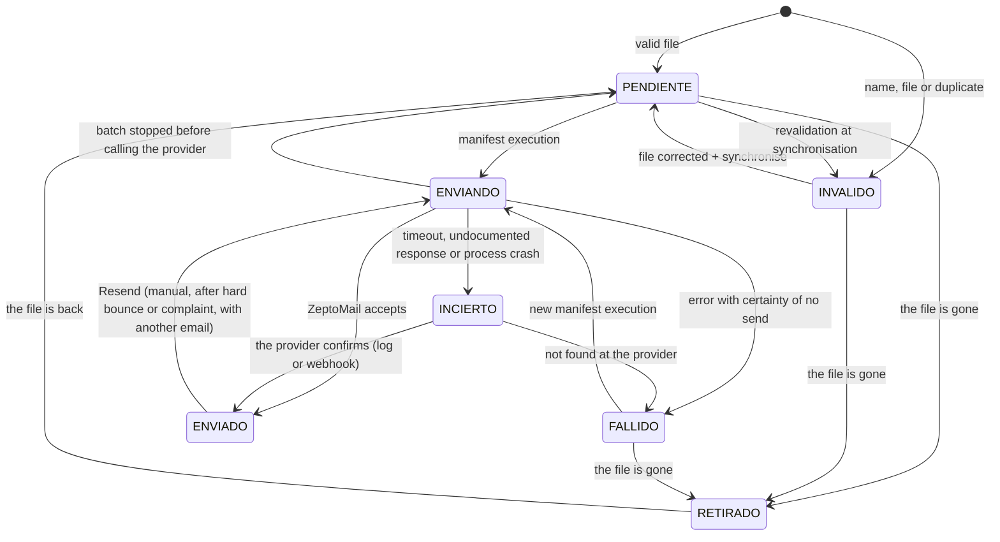
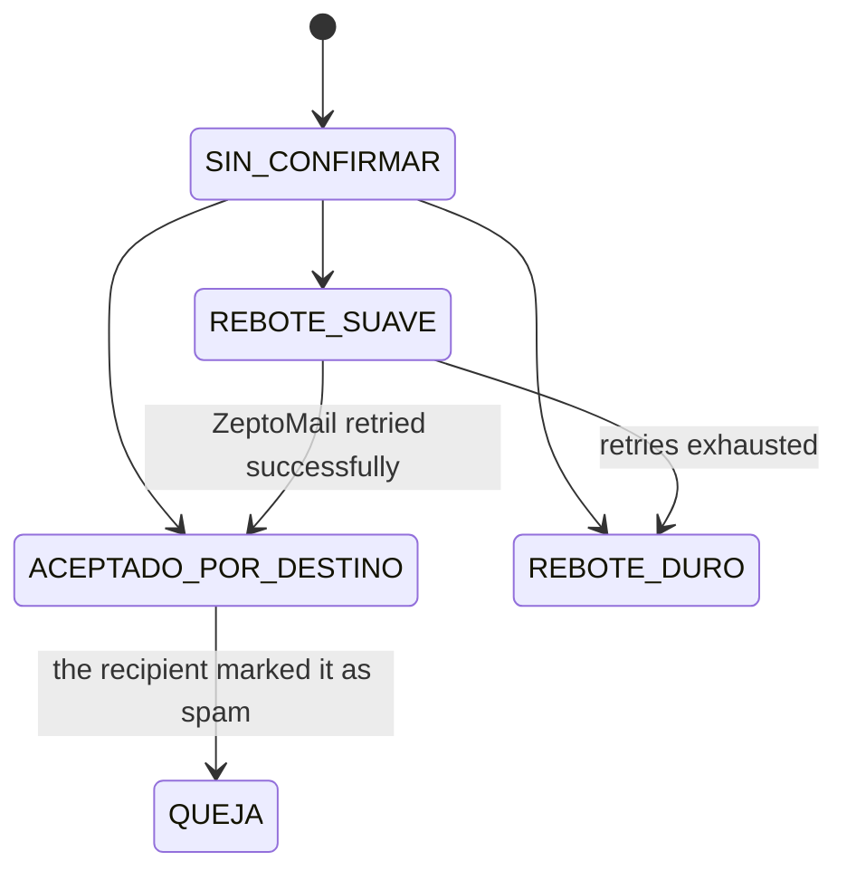
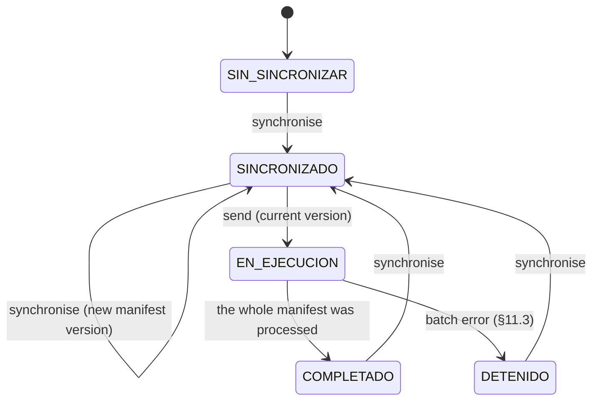

# 7. State model

## 7.1 Receipt identity

- Each receipt is identified by the **SHA-256 of its content**.
- The hash is recorded together with the period, block, path, name, concept, contract and validation verdict.

| Situation at synchronisation | Treatment |
|---|---|
| The hash is new | New record (`PENDIENTE` or `INVALIDO`). |
| The hash already exists in the same batch and its previous name is gone | **Renamed.** Name, concept and contract are updated, and it is revalidated. If the receipt was `ENVIADO`, it keeps that state and its history records "renamed after send", which is highlighted in the interface. |
| The same hash appears twice in the directory | The one already registered is kept. If both are new, the first in alphabetical order. The other copy becomes `INVALIDO / DUPLICADO`. |
| The hash exists in another block or period, in a state other than `RETIRADO` | `INVALIDO / DUPLICADO`. |
| The file cannot be read (locked, no permissions, deleted during reading, 0 bytes) | Not registered as a receipt. It appears as a **synchronisation incident** (`ARCHIVO_NO_ACCESIBLE`), identified by its path. It enters with its hash once it can be read. |

`DUPLICADO` is **re-evaluated on every synchronisation**. Thus, a file moved from one block to another is resolved once both blocks are synchronised.

## 7.2 Receipt send state

| State | Meaning |
|---|---|
| `PENDIENTE` | Valid and not sent. It enters the manifest if its recipient is resolved. |
| `INVALIDO` | The file prevents sending. `tipo_error` states the reason. Fixed by changing the file and synchronising. |
| `ENVIANDO` | An attempt is in progress. Before calling the provider, the attempt is recorded with its `intento_id`. |
| `ENVIADO` | ZeptoMail accepted the email. **A batch execution never includes it again.** Only the manual *Resend* action (§10.4) takes it out of this state. |
| `FALLIDO` | Typed error, with certainty that it was not sent. It is retried when the operator executes the batch. |
| `INCIERTO` | It is unknown whether ZeptoMail received the email. **Never resent automatically**: resolved by reconciliation (§9.4). |
| `RETIRADO` | The file was removed from the directory. A receipt that is `ENVIADO` or `INCIERTO` never becomes `RETIRADO`. |

Each receipt records `intentos`, `tipo_error`, `detalle_error` and its full history.

## 7.3 Delivery state (only for `ENVIADO` receipts)

Updated by ZeptoMail webhooks (§12.5) and by reconciliation (§9.4).

- `ACEPTADO_POR_DESTINO` means the recipient's mail server accepted the message. **It does not guarantee it reached the inbox**: it may have been filtered as spam.
- `REBOTE_SUAVE` is intermediate. ZeptoMail retries on its own and no action is required.
- **The delivery state only advances.** An event that arrives late never moves the state back (e.g. a soft bounce after an accepted). Same-level conflicts are recorded as an anomaly.

## 7.4 Batch state

- **There is only one execution at a time in the whole system.** While it runs, *Synchronise*, *Send* and *Resend* are disabled.
- `DETENIDO` records the reason. Receipts that were not reached remain `PENDIENTE`.
