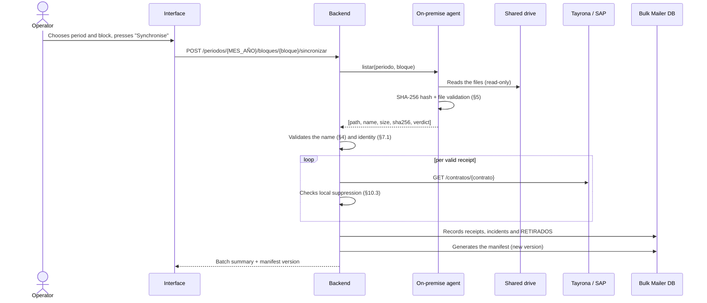
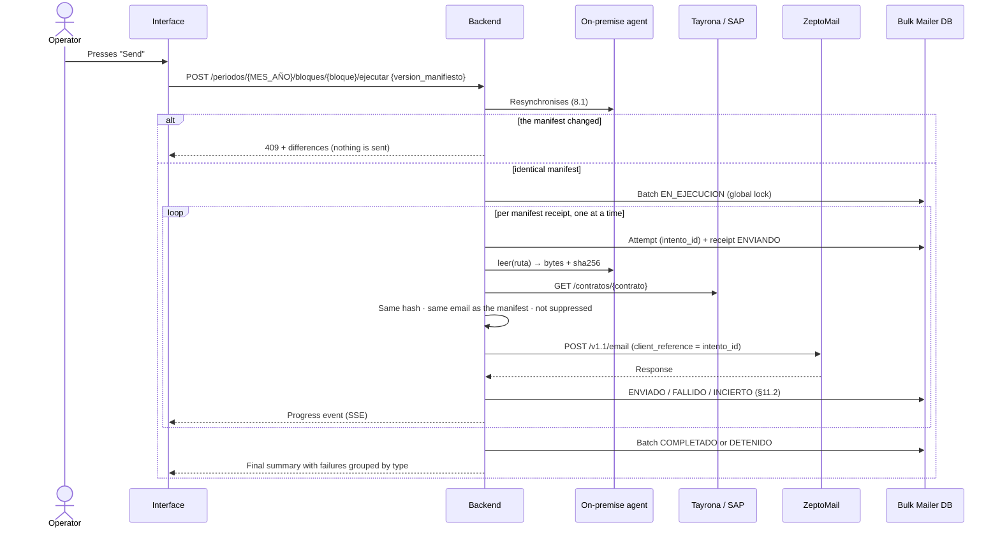

# 8. Operational flow

## 8.1 Synchronise

The operator does not upload files through the interface. To change the batch, they add, remove or rename files in `MES_AÑO/BLOQUE` and press **Synchronise**.

During synchronisation **no PDF travels to the cloud**: only metadata, hashes and verdicts.

## 8.2 Review

The batch summary shows, per receipt:

> file name · concept · contract · **complex name (per the source)** · **destination email** · state · error type

and divides it into two groups:

- **Ready to send:** `PENDIENTE` or `FALLIDO`, with the recipient resolved. These are exactly the ones that form the manifest.
- **Need correction:** `INVALIDO`, synchronisation incidents and receipts without a resolved recipient (non-existent, inactive, email-less or suppressed contract, or source unavailable).

It also shows whether the **archive copy** (§10.5) is active.

The graphic design of the interface is defined in a later iteration. This document only fixes the minimum information (§13).

## 8.3 Send

- Sends are **sequential**, one at a time, with a configurable pause between them. At this volume, parallelism adds nothing and increases the risk of rate limiting by the provider.
- The PDF is read into memory, sent and discarded. **No copy is kept in the cloud.**
- When the batch pauses after an uncertain response (§9.2.1), a progress event is emitted **before the wait starts** with the reason, the consecutive-incident count, the wait in seconds and the time at which the next send is due. The interface shows that state so the operator knows the batch is waiting, not stuck. The wait is also recorded in the batch history.

**Differences reported with the `409`.** A manifest is a list of receipts, each with hash, name, concept, contract and resolved email. Comparing the version the operator sent with the one produced by the resynchronisation yields exactly four kinds of difference:

| Type | What changed between review and send | Example |
|---|---|---|
| `AGREGADO` | A hash that was not in the manifest is now ready | A name was corrected and the receipt became `PENDIENTE` |
| `EXCLUIDO` | A hash that was in the manifest is no longer ready | The file was removed, the email was suppressed, the source stopped answering |
| `RENOMBRADO` | Same hash; name, concept or contract changed | The PDF was renamed |
| `DESTINATARIO_CAMBIO` | Same hash and contract; the email changed | The email was corrected in Tayrona or SAP |

A file modified inside is not a separate type: its hash changes, so it appears as `EXCLUIDO` plus `AGREGADO`. The `409` body carries the list of differences, each with type, hash, name, previous value and new value. The interface shows them and disables *Send* until a new synchronisation.

## 8.4 Manual retry

1. The interface shows the `FALLIDO` receipts grouped by error type, with the suggested action (§11).
2. The operator fixes the cause: renames the file, asks for the contract or email to be corrected in the source, or waits for the service to recover.
3. Presses **Synchronise**, reviews the new manifest and presses **Send**. Only ready receipts are processed; `ENVIADO` ones never enter the manifest.
